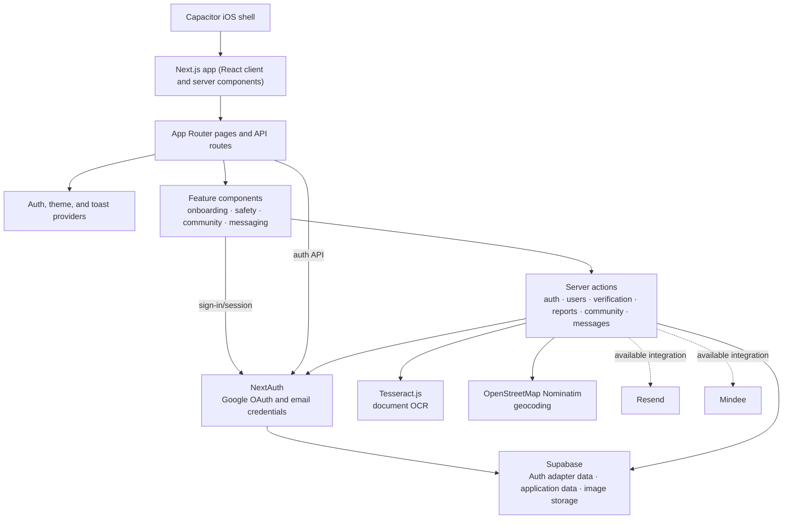
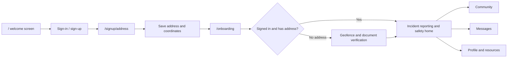

# Verifeye architecture

## System map

Solid arrows show integrations visible in the current application code. Resend
and Mindee are listed as dependencies, but are not currently imported by the
application.

## Main user flow

## Code organization

- `app/` contains App Router pages, API routes, and server actions.
- `components/features/` contains onboarding, safety, community, messaging,
  profile, and resources UI.
- `components/ui/` and `components/providers/` contain shared primitives and
  app-wide providers.
- `auth.ts` configures NextAuth with Google and credentials providers and the
  Supabase adapter.
- `supabase/migrations/` contains SQL migrations; Supabase is also used for
  application data and report-image storage.
- `ios/` contains the Capacitor iOS project.

## Important implementation paths

- Document verification: `DocumentUpload` calls the `verifyUserDocument`
  server action, which uses Tesseract.js OCR.
- Report images: the authenticated `/api/upload-image` route uploads to the
  Supabase `report-images` storage bucket.
- User profile/address operations: `app/actions/user.ts` reads and writes
  profile data and uses Nominatim for geocoding.
- Feature data: server actions in `app/actions/` mediate report, community,
  and message operations with Supabase.
